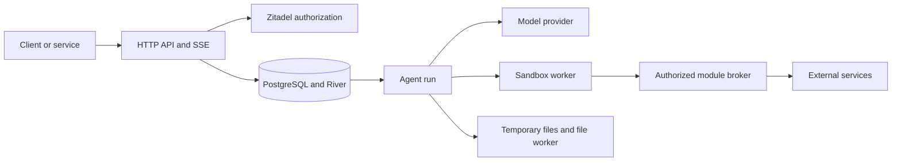

# Loom

Loom is an agent API service built with Go and PostgreSQL. It accepts a request and a Zitadel identity, runs a model-driven task, calls authorized service modules, and records history, results and credit usage.

Clients use HTTP requests and durable SSE events. A client can answer questions, send steering messages, approve an action, or resume a paused run. JavaScript runs in a separate sandbox process. File tools pass temporary IDs instead of complete files through JavaScript.

## Start here

| Your task | Read |
| --- | --- |
| Work on the code | [Contributing and code map](CONTRIBUTING.md) |
| Run a development instance | [Local setup](docs/running.md), [startup and keys](docs/startup.md) |
| Build a client | [HTTP API](docs/api.md), [conversation and confirmation](docs/conversational-input.md) |
| Add a service module | [Module contract and help requirements](docs/modules.md) |
| Operate an installation | [Operations](docs/operations.md), [diagnostics](docs/diagnostics.md) |
| Test a change | [QA guide](docs/qa.md), [integration fixtures](integration/README.md) |
| Check scope | [Limitations](docs/mvp-limitations.md), [development track](docs/development-track.md) |

## Request path

The database owns durable state. The broker checks authority before each module call; the sandbox receives no credentials.

## Runtime

The deployment target is Linux/amd64 with Docker. PostgreSQL stores run state, River jobs, history, authorization sessions and the credit ledger. Zitadel supplies identities and roles. OpenAI is the default model provider; development providers are available for manual and deterministic tests.

The API, sandbox supervisor and file worker have separate roles. Workers do not receive identity or provider secrets. A restricted Docker API proxy supplies module discovery. One nonterminal run owns a chat; different chats can run concurrently. Passive user actions add history but do not start a run.

Use the [development Compose](compose.yaml) and [configuration template](deploy/config.example.yaml) for local setup. They require your issuer, credentials, model policy and roles. They are not a complete production profile. Hostnames, ingress, secrets, backups and collector configuration belong to the operator. No specific hosting provider or deployment repository is required.

## Contracts and configuration

- [Architecture](docs/architecture.md), [trust boundaries](docs/security.md), [data and accounting](docs/data.md).
- [Startup and migrations](docs/startup.md), [configuration rules](docs/implementation.md), [supported fields](internal/config/SUPPORT.md).
- [Manifest example](examples/manifest.json) and [manifest schema](schemas/manifest.schema.json).
- [Skills and procedural context](docs/skills.md).
- [User memory](docs/user-memory.md), [file tools](docs/file-tools.md), [file worker](docs/file-worker.md).
- [OpenAI settings and cost](docs/openai.md), [context compaction](docs/active-compaction.md), [test providers](docs/test-providers.md).
- [Failures](docs/failures.md), [retry policy](docs/hybrid-retry.md), [caller recovery](docs/caller-recovery.md).
- [Operator login](docs/operator-login.md), [session-key rotation](docs/session-key-rotation.md), [restore barrier](docs/recovery-mode.md).
- [Logs and metrics](docs/observability.md), [OpenTelemetry](docs/opentelemetry.md), [CI and images](docs/ci.md).

The Go module is github.com/complynx/loom. Existing CLX_* settings and clx.harness.* discovery labels are stable interface names. Go dependencies use go.mod/go.sum; there is no separate dependency lock. Base images and CI actions use reviewed digests/commits.

The repository contains reproducible tests and QA instructions. Store run reports, screenshots and dumps outside source control. Required dependency notices remain in the repository and images.
