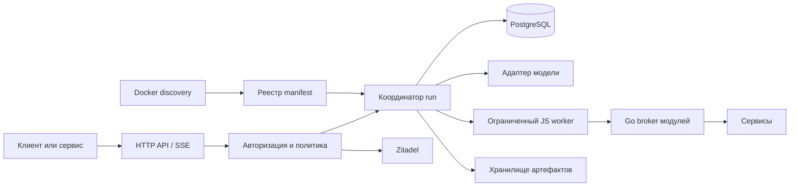

# Архитектура v1

Авторизация использует [ограниченный positive cache и общую инвалидацию](identity-cache.md). Финальные permissions и локальные ограничения пересчитываются на существующих границах; sensitive operations обходят кэш.

## Цель и контекст

Сервис принимает пользовательское поручение, авторизует инициатора, выполняет агентский цикл, сохраняет историю и результаты, учитывает стоимость. Клиент может получать события, отвечать на вопросы, уточнять поручение, приостанавливать и возобновлять запуск.

На 2026-10-10 в соседнем `server_configs` проверены локальные файлы: Traefik Docker provider с `exposedByDefault: false`, PostgreSQL 17 с pgvector, Zitadel с указанным образом v4.16.3. `zitadeltg` обеспечивает Telegram login; Touchzouk использует Go/OIDC. Это сведения из репозиториев, а не проверка запущенного сервера. Секреты и соседние сервисы не изменялись.

Текущий реализованный срез и границы QA описаны в [ограничениях](mvp-limitations.md). Ниже архитектурные решения; детали wire/schema задают migrations и OpenAPI. Порядок старта, миграции и ключи описаны в [startup](startup.md).

## Компоненты

- HTTP API отвечает за контракты, аутентификацию, idempotency и доставку событий.
- Координатор владеет состоянием run, очередью входов, бюджетом, шагами и отменой.
- Адаптер модели преобразует возможности конкретного провайдера в общий контракт. Не обещает одинаковые effort, модальности, отмену или восстановление у разных моделей.
- JS worker исполняет код. Go broker отдельно проверяет каждый вызов и отправляет запрос сервису. Worker не получает credentials.
- PostgreSQL хранит историю, очередь, аренды исполнения, политики, бюджет и журнал операций.
- Discovery читает доверенную deployment-конфигурацию Docker. Manifest описывает сервис; не выдаёт пользователю права.
- Blob-хранилище временно держит содержимое файлов (24 часа по умолчанию); БД — метаданные, сроки и ссылки. Долгоживущими оригиналами владеют внешние сервисы; повторное получение идёт через авторизованный read API по внешнему ID.

Один бинарник предоставляет режимы `serve`, `sandbox`, `docker-api-proxy` и `migrate`; sandbox supervisor создаёт отдельные worker processes. Первоначально одна API-реплика, несколько изолированных workers. Корректность владения run обеспечивается БД, а не числом реплик. Отдельный брокер очередей и Redis в v1 не нужны.

## Основные решения

1. Пользователь идентифицируется парой `(issuer, subject)`, а не именем или email. Организация задаёт область авторизации и биллинга.
2. Subject, actor и billing account — независимые сущности. Сервис не выбирает произвольного пользователя или плательщика без делегации.
3. У пользователя один дефолтный чат. Отсутствующий `chat_id` разрешается в него атомарно. Явный ID должен пройти проверку доступа.
4. На чат приходится один нетерминальный run. Ожидание ввода и пауза сохраняют этот слот. Это исключает запуск конкурирующего поручения поверх незавершённого. Другой чат может работать параллельно.
5. В v1 новый run при занятом чате получает `409 chat_busy`. Неявной очереди нет. Steering адресуется существующему run явно.
6. Пассивное событие пользователя никогда не запускает агента. Оно доступно следующему run либо текущему между шагами.
7. История сохраняется полностью согласно retention. Модель получает выжимку старой части, свежий участок и результаты поиска по необходимости.
8. Продолжение восстанавливает агентское состояние и завершённые шаги. JS heap, стек и незавершённая генерация не восстанавливаются.
9. Изменяющий вызов сначала получает сохранённое намерение и idempotency key. Неопределённый результат сверяется до возможного повторения.
10. Изменение defaults влияет на новые run. Отзыв доступа и блокировка применяются перед следующими действиями действующего run.

## Состояния run

| Состояние | Значение | Допустимый выход |
|---|---|---|
| `queued` | Принят и сохранён, ждёт worker | `running`, `paused`, `cancelled`, `failed` |
| `running` | Выполняет агентские шаги | Все состояния ожидания, `paused`, терминальные |
| `waiting_input` | Ожидает ответ на вопрос | `queued`, `paused`, `cancelled`, `failed` |
| `waiting_approval` | Ожидает согласие на действие | `queued`, `paused`, `cancelled`, `failed` |
| `waiting_auth` | Нужна новая авторизация | `queued`, `paused`, `cancelled`, `failed` |
| `reconciling` | Есть операция с неизвестным результатом | `queued`, `paused`, `cancelled`, `failed` |
| `paused` | Исполнение остановлено и допускает продолжение | `queued`, `cancelled`, `failed` |
| `completed` | Поручение завершено | Нет |
| `cancelled` | Поручение отменено | Нет |
| `failed` | Продолжение этого run невозможно | Нет |

`pause_requested` и `cancel_requested` — durable флаги, а не мгновенное обещание остановки. Причина состояния хранится отдельно: `shutdown`, `budget_exhausted`, `dependency_unavailable`, `wait_expired` и другие коды.

Истечение срока вопроса или паузы завершает run с `failed / wait_expired` согласно политике. Новое поручение после этого может использовать прежний чат. Операции `unknown` продолжают учитываться и сверяться даже после отмены или завершения run.

## Шаг исполнения

1. Получить аренду run и актуальный fencing token.
2. Проверить блокировки, авторизацию и ожидающие управляющие входы.
3. Собрать разрешённый контекст и инструменты; зафиксировать использованный диапазон событий.
4. Зарезервировать бюджет оплачиваемого шага.
5. Сохранить намерение шага, затем выполнить модель или инструмент.
6. Сохранить результат и расходы, добавить события в той же транзакции.
7. Применить входы, появившиеся во время шага; выбрать следующий шаг или ожидание.

Параллельность разрешена внутри шага: несколько независимых вызовов модулей. Записывающие действия над одним ресурсом по умолчанию последовательны. Завершение каждого вызова сохраняется независимо; `Promise.all` не отменяет уже выполненные действия при ошибке соседнего promise.

## Отдельные виды времени

- Общая длительность run, включая ожидания, ограничивает срок поручения.
- Активное время ограничивает вычисления, не включает ожидание пользователя.
- Deadline скрипта включает ожидание всех его RPC.
- Метод имеет собственный deadline, не превышающий оставшееся время скрипта.
- Shutdown имеет независимый предельный срок 5 секунд, цель нормального завершения — 1 секунда.

Все проверки сроков в БД используют UTC и серверное время. `occurred_at` от сервиса не определяет авторизацию, порядок исполнения или сроки подтверждения.
