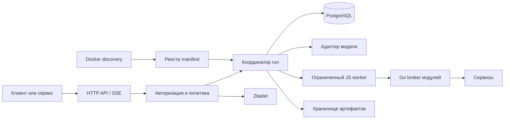

# Runtime

[Guide index](../architecture.md)

## Цель и контекст

Сервис принимает пользовательское поручение, авторизует инициатора, выполняет агентский цикл, сохраняет историю и результаты, учитывает стоимость. Клиент может получать события, отвечать на вопросы, уточнять поручение, приостанавливать и возобновлять запуск.

Приложение отделено от серверного профиля: topology, ingress, secrets и collector принадлежат deployment-репозиторию оператора.

Текущий реализованный срез и границы QA описаны в [ограничениях](../mvp-limitations.md). Ниже архитектурные решения; детали wire/schema задают migrations и OpenAPI. Порядок старта, миграции и ключи описаны в [startup](../startup.md).
## Компоненты

- HTTP API отвечает за контракты, аутентификацию, idempotency и доставку событий.
- Координатор владеет состоянием run, очередью входов, бюджетом, шагами и отменой.
- Адаптер модели преобразует возможности конкретного провайдера в общий контракт. Не обещает одинаковые effort, модальности, отмену или восстановление у разных моделей.
- JS worker исполняет код. Go broker отдельно проверяет каждый вызов и отправляет запрос сервису. Worker не получает credentials.
- PostgreSQL хранит историю, очередь, аренды исполнения, политики, бюджет и журнал операций.
- Discovery читает доверенную deployment-конфигурацию Docker. Manifest описывает сервис; не выдаёт пользователю права.
- Blob-хранилище временно держит содержимое файлов (24 часа по умолчанию); БД — метаданные, сроки и ссылки. Долгоживущими оригиналами владеют внешние сервисы; повторное получение идёт через авторизованный read API по внешнему ID.

Один бинарник предоставляет режимы `serve`, `sandbox-supervisor`, `sandbox-worker`, `docker-proxy`, `file-worker` и `migrate`; sandbox supervisor создаёт отдельные worker processes. Первоначально одна API-реплика, несколько изолированных workers. Корректность владения run обеспечивается БД, а не числом реплик. Отдельный брокер очередей и Redis в v1 не нужны.
## Основные решения

1. Пользователь идентифицируется парой `(issuer, subject)`, а не именем или email. Организация задаёт область авторизации и биллинга.
2. Subject, actor и billing account — независимые сущности. Сервис не выбирает произвольного пользователя или плательщика без делегации.
3. У пользователя один дефолтный чат. Отсутствующий `chat_id` разрешается в него атомарно. Явный ID должен пройти проверку доступа.
4. На чат приходится один нетерминальный run. Ожидание ввода и пауза сохраняют этот слот. Это исключает запуск конкурирующего поручения поверх незавершённого. Другой чат может работать параллельно.
5. В v1 новый run при занятом чате получает `409 chat_busy`. Неявной очереди нет. Steering адресуется существующему run явно.
6. Пассивное событие пользователя никогда не запускает агента. Оно доступно следующему run либо текущему между шагами.
7. История сохраняется полностью согласно retention. Модель получает выжимку старой части, свежий участок и результаты поиска по необходимости.
8. Продолжение восстанавливает агентское состояние и завершённые шаги. JS heap, стек и незавершённая генерация не восстанавливаются.
9. Изменяющий вызов сначала получает сохранённое намерение и idempotency key. Неопределённый результат сверяется до возможного повторения.
10. Изменение defaults влияет на новые run. Отзыв доступа и блокировка применяются перед следующими действиями действующего run.
11. При `interaction.reply_mode=agent` обычные сообщения и подсказки-кнопки идут одним потоком steering. Ожидающее действие не мешает уточнять поручение; одновременно подтверждается одно действие на чат. Критический метод может требовать отдельный бинарный callback или точную фразу без интерпретации моделью.
